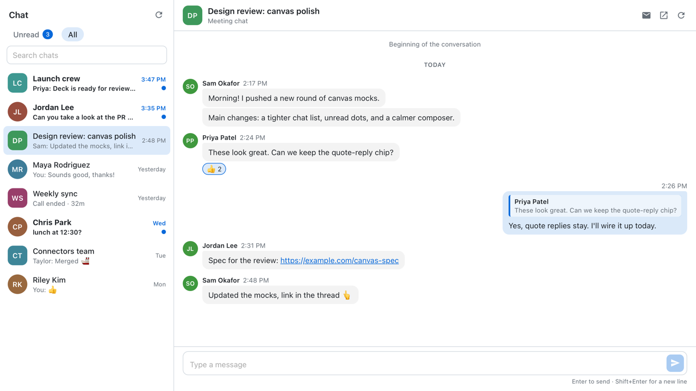

# Copilot plugins

GitHub Copilot plugins by [Dhruv Chand](https://github.com/dhruvchand).

## Plugins

| Plugin | Description |
| --- | --- |
| [teams-lite](plugins/teams-lite) | A thin Microsoft Teams chat canvas: unread inbox, conversations, and replies through the WorkIQ connector. |



## Install

Add this marketplace once, then install any plugin from it:

```sh
copilot plugin marketplace add dhruvchand/copilot-plugins
copilot plugin install teams-lite@dhruvchand-plugins
```

Plugins installed with the Copilot CLI also show up in the GitHub Copilot app, which shares `~/.copilot`.

To update later, run `copilot plugin update teams-lite@dhruvchand-plugins`.

## License

[MIT](LICENSE)
