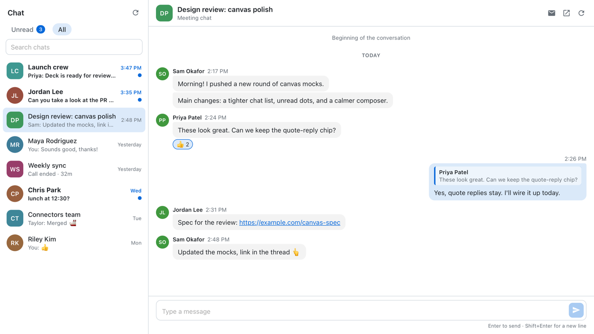

# Teams Lite

A thin Microsoft Teams chat client for the GitHub Copilot app. It opens as a side-panel canvas and only does messaging.



## Features

- Unread and All chat lists with search. The list refreshes every 20 seconds while the canvas is open.
- Read conversations, including links, images, quotes, and reactions, and reply. Enter sends; Shift+Enter adds a new line.
- Quote-reply, mark chats read or unread, and open a chat in Teams.
- Copilot can list unread chats, read a chat, and draft a reply into the composer. It never sends; you review the draft and press Send.

## Requirements

- The GitHub Copilot app, with canvas extensions enabled.
- The WorkIQ connector, connected and signed in to your Microsoft 365 account.

## Install

With the Copilot CLI (it shares `~/.copilot` with the app):

```sh
copilot plugin marketplace add dhruvchand/copilot-plugins
copilot plugin install teams-lite@dhruvchand-plugins
```

Or ask Copilot in the app to install the extension from `https://github.com/dhruvchand/copilot-plugins/tree/main/plugins/teams-lite/com.github.copilot/extensions/teams-lite`.

Then ask Copilot to "open the Teams canvas".

## How it works

- All Microsoft 365 access goes through your session's WorkIQ connector, so the extension never handles your tokens. It only uses a WorkIQ server provided by a connector, a plugin, or your own MCP configuration, never one defined by a repository.
- The UI is served on `127.0.0.1` and protected by a per-session token.
- Display names and unsent drafts are cached in `~/.copilot/extensions/teams-lite/.cache/` with owner-only permissions.

## Limitations

Microsoft Graph sometimes rate-limits chat history through WorkIQ. When that happens:

- The chat shows only its latest message.
- You can still reply.
- History loading retries automatically.
- The chat isn't marked read automatically until its full history loads.
